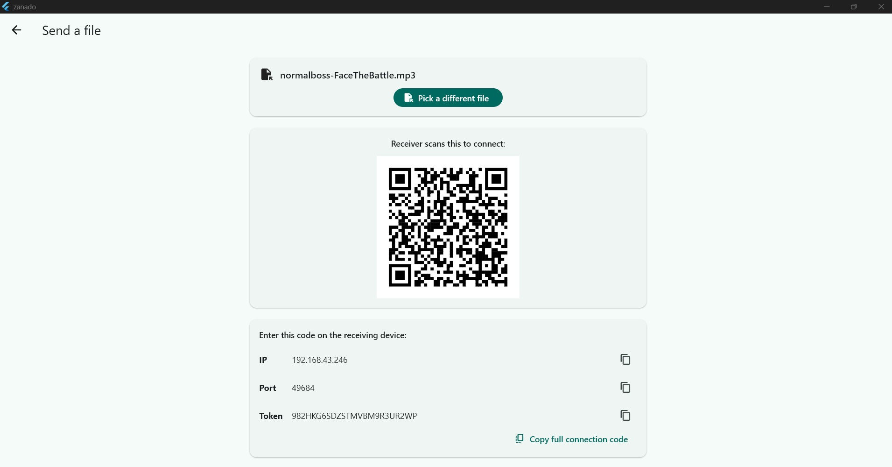
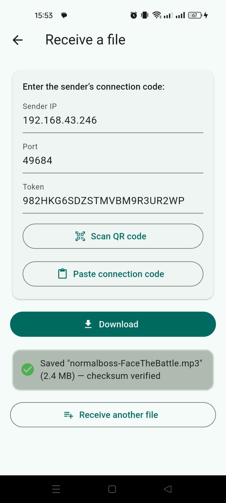
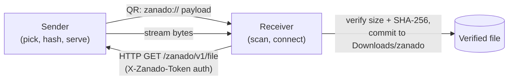

# Zanado

A fast, private, offline file-transfer app for **Android ↔ Windows** over your local Wi-Fi network. No cloud, no accounts, no cables — just pick a file on one device, scan a QR code with the other, and the file lands in the receiving device's Downloads folder, checksum-verified.

---


<table style="width: 100%; border-collapse: collapse; border: none;">
  <tr>
    <td style="text-align: center; border: none; padding: 10px;">
      
    </td>
    <td style="text-align: center; border: none; padding: 10px;">
      
    </td>
  </tr>
</table>


---

## Why I built this

My previous file movement process are either through Gdrive or connect the phone to the laptop directly, and both are not an efficient way to do it. We're wasting internet package through Gdrive or I should prepare the phone to be connected to laptop, which I think all of these problems will be solved with just scanning QR code.

Although I think SHAREit actually facilitate transfer between 2 device (type agnostic), the 2nd reason made me decide to built it anyway. I want to have my own media player, since now native media player app on android always have ads (not helping when SHAREit itself also have ads for free version). I see great potential that the app could become device utility to some extent, which made me decide to build **Zanado**.

It is the first version (a ready-to-use prototype) of the app with file transfer as its main feature. Future improvement is listed as something I already planned to implement in [Future direction](#future-direction).

## How it works

1. **Sender** picks a file, computes its size + SHA-256, and starts a short-lived one-shot HTTP server on the LAN.
2. The sender shows a **QR code** encoding a `zanado://` connection payload (host, port, one-time token).
3. **Receiver** scans the QR (or pastes/enters the code on Windows) and connects.
4. The file streams directly to the receiver, is staged safely, and is committed to `Downloads/zanado` **only after** size and checksum verification pass — a failed or interrupted transfer never leaves a corrupt file behind.



## Current capabilities (v1.0)

- **End-to-end LAN transfer** between Android and Windows over the same Wi-Fi (verified on physical devices, including 3.7 GB files).
- **QR pairing** on Android; paste-code / manual entry on Windows.
- **Integrity you can see:** SHA-256 checksum and byte-size verified on the receiver; checksum failure deletes the partial file and reports the error.
- **User-visible storage:** received files go to `Downloads/zanado` (public Downloads via MediaStore on Android) — visible to file managers, no storage permissions required on API 29+.
- **Hardening:** token-gated one-shot server, receiver idle timeout, stale `.part` cleanup, session expiry handling, duplicate-name auto-rename, path-traversal sanitization.
- **Adaptive UX:** platform-decided layouts (desktop composition on Windows, stacked touch layout on Android), shared status banners and visual tokens.

## Limitations

These are known, deliberate v1.0 trade-offs:

- **No resume:** an interrupted transfer restarts from zero bytes.
- **No multi-file transfer:** one file per session.
- **Receiver-completion awareness:** the sender cannot always distinguish a receiver abort from a normal stream end (dart:io buffering), so its success message never claims receiver success.
- **Expired-session errors are generic:** a stale QR surfaces as a connection timeout rather than an explicit "session expired" message.
- **Plain HTTP on the LAN:** transfers are token-gated but unencrypted; TLS is a planned improvement.
- **Storage screen is not a file browser:** it lists only files received and managed by Zanado.

## Setup & run

### Prerequisites

- Flutter SDK (verified with Flutter 3.47.7 / Dart 3.13.5)
- Android toolchain (Gradle 9.3.1, AGP 9.1.0, Kotlin 2.4.0, JDK 21) for Android builds
- Visual Studio Build Tools (C++ workload) for Windows builds
- Both devices on the **same LAN** for transfer testing

### Get started

```bash
git clone <repository-url>
cd zanado
flutter pub get
flutter run                # pick a device when prompted (Android phone or Windows)
```

### Test & analyze

```bash
flutter analyze            # static analysis — must be zero issues
flutter test               # unit tests (136 tests)
```

### Release builds

```bash
flutter build apk --release     # → build/app/outputs/flutter-apk/app-release.apk
flutter build windows --release # → build/windows/x64/runner/Release/zanado.exe
```

For the full toolchain table, clean-build procedure, and known build failure modes, see [docs/development.md](docs/development.md).

## Documentation

| Document | What it covers |
|---|---|
| [docs/architecture.md](docs/architecture.md) | How the app works: layers, storage, transfer, security |
| [docs/architectural-decisions.md](docs/architectural-decisions.md) | The "why" behind each major decision |
| [docs/development.md](docs/development.md) | Setup, toolchain, build & test guide |
| [docs/troubleshooting.md](docs/troubleshooting.md) | Symptom-based runtime and transfer problem guide |
| [docs/future-improvements.md](docs/future-improvements.md) | Roadmap ideas |
| [docs/release-notes.md](docs/release-notes.md) | v1.0 status and verified limitations |
| [docs/diagrams/transfer-flow.md](docs/diagrams/transfer-flow.md) | Sequence diagrams: sender/receiver transfer lifecycle |
| [docs/diagrams/storage-flow.md](docs/diagrams/storage-flow.md) | Diagrams: platform storage split, commit path, list refresh |
| [docs/release-test-v1.0.md](docs/release-test-v1.0.md) | Full release verification report (13/15 pass) |

## Future direction

Planned, not implemented in v1.0:

- **Multi-file transfer UX** — queues, per-file progress, partial-failure reporting and retry.
- **Receiver-completion acknowledgment** — so the sender can distinguish a receiver abort from a normal stream end.
- **Media playback** — open received audio/video via content URIs without copying.
- **Encrypted transfer (TLS)** — trust-on-first-use pairing over the LAN.
- **Transfer resume** — resume from the `.part` byte offset (HTTP `Range`), with full-file checksum verification after resume.

## License

<!-- RESERVED: choose a license and add its text here. -->

