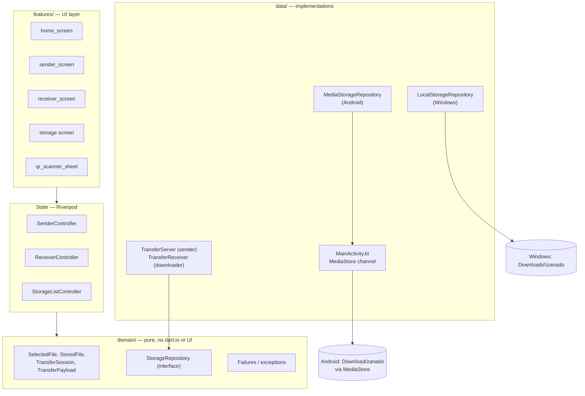

# Architecture

Zanado is a single Flutter codebase for Android and Windows, organized in four layers with strict dependency direction:

```
features → domain ← data
```

UI code depends only on domain models and repository interfaces; platform-specific implementations live in the data layer and are chosen at startup in the composition root (`main.dart` → `lib/data/storage/storage_providers.dart`).



## Layers

### features/ — UI and Riverpod controllers

- `home_screen`, `sender_screen`, `receiver_screen`, storage screen, QR scanner sheet.
- Controllers (`SenderController`, `ReceiverController`, `StorageListController`) own all async transfer/storage state; screens are stateless views.
- Shared presentation: `lib/shared/status_banner.dart`, `visual_tokens.dart`. Layout composition is decided by platform (`defaultTargetPlatform`): desktop composition on Windows, stacked touch layout on Android; width only tunes details inside the Windows layout.

### domain/ — pure models and contracts

- `SelectedFile` (name, path, sizeBytes, sha256) — picked on the sender; **size and hash must describe the file bytes, never string lengths**.
- `TransferSession` — token + expiry, duration clamped to 30 s–30 min (default 10 min).
- `TransferPayload` — the `zanado://transfer?host=&port=&token=&expires=` QR payload with validation and expiry.
- `StorageRepository` interface — list / saveFromFile / saveStream / delete / directoryPath; UI never sees the concrete implementation.
- `FileNameUtils` — sanitize filenames, split extension, generate `name (1).ext` copy suffixes; rejects path traversal.

### data/ — network and storage implementations

- **Sender** (`TransferServer`): one-shot `dart:io` `HttpServer` bound to anyIPv4 on an ephemeral port; serves exactly one selected file; token-authenticated; streams with backpressure; shuts down on any terminal state.
- **Receiver** (`TransferReceiver`): `dart:io` `HttpClient` with a 10 s connect timeout and a 30 s idle timeout; streams the body to `.part` and verifies size + SHA-256 before committing.
- **Storage** (`LocalStorageRepository` on Windows, `MediaStorageRepository` on Android) behind one interface; see [Storage flow](diagrams/storage-flow.md).

## Wire protocol

Defined in `lib/core/constants/transfer_protocol.dart` (version 1):

- Endpoint: `GET /zanado/v1/file`
- Headers: `X-Zanado-Token` (auth), `X-Zanado-Protocol` (version echo), `X-Zanado-Checksum` (64-char lowercase hex sha-256), `X-Zanado-File-Name` (percent-encoded UTF-8 name)
- Response codes: 200 stream; 400 bad version; 401 missing/unknown token; 403 expired; 404 unreadable file; 409 second receiver (single-receiver enforcement)
- Errors are JSON `{"error": "<code>"}` with machine-readable codes

## Security model

- The token is a random short-lived credential; the server rejects missing, invalid, or expired tokens, and the token never appears without the session.
- Session expiry gates **new connections only** — an accepted stream always completes.
- The server serves only the explicitly selected file; filenames are sanitized and path traversal is rejected before anything is written.
- Transfers are **plain HTTP over the local network** — token-gated but unencrypted. TLS is a planned improvement; Zanado is intended for trusted LANs.

## Integrity invariants

1. **No checksum match → no completed file.** The receiver writes streamed bytes to `.part`, verifies size and SHA-256, and only then commits; a mismatch deletes the stored file.
2. **One-shot session:** any terminal state closes the listener; token and port are never reused.
3. **Sender `completed` ≠ receiver success:** transport buffering can hide a vanished receiver, so the receiver's checksum verification is the authoritative success signal. The sender's success message never claims receiver success.
4. **Large files are memory-safe:** sender streams the file directly, receiver streams network bytes to disk, hashing is incremental — the whole file is never in memory.
5. **Storage list refresh:** a shared `storageListRevisionProvider` is bumped only after a successful commit (`DownloadSuccess`), so a mounted storage screen updates live; failed or cancelled downloads never refresh it.

Detailed sequence diagrams: [Transfer flow](diagrams/transfer-flow.md) and [Storage flow](diagrams/storage-flow.md).
