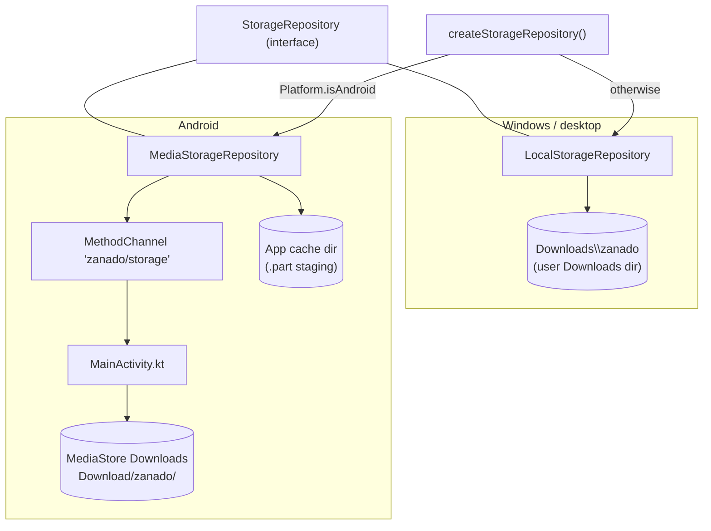

# Storage flow

Received files are committed through the same `StorageRepository` the storage feature uses, with a platform-specific implementation chosen at startup (`main.dart` → `createStorageRepository()` in `lib/data/storage/storage_providers.dart`).

## Platform split



## Commit path

### Windows (`LocalStorageRepository`)

1. Write streamed bytes to `<file>.part` in `Downloads/zanado`.
2. Verify the expected byte size; close the stream **before** any error-path deletion (Windows cannot delete an open file).
3. Atomic rename to the final name; an existing name is never overwritten — a copy suffix (`name (1).ext`) is generated.
4. On failure, delete the `.part` artifact; no partial file is ever shown as complete.

### Android (`MediaStorageRepository` + `MainActivity.kt`)

1. Write streamed bytes to a `.part` file in the app cache dir (staging).
2. Send the staged file to the Kotlin side via `MethodChannel 'zanado/storage'`.
3. Kotlin inserts a MediaStore entry with `IS_PENDING=1`, copies the file into `Download/zanado/`, verifies the size, and only then publishes (`IS_PENDING=0`) — the MediaStore equivalent of the `.part`-then-rename pattern. A failed write leaves no completed file.
4. The multi-GB MediaStore copy runs on a **background executor** (`runPublishInBackground`), with the result posted back to the main thread via `mainHandler` with detach-safe guards. Running it on the main thread caused an Android ANR (RC-03: a 3.56 GB receive was killed by "MainThread worked timeout" *after* success — the process died seconds later, which looked like a completion crash). Durable rule: **MethodChannel handlers must never do multi-GB synchronous I/O on the main thread.**
5. Requires API 29+ (MediaStore.Downloads); no storage permissions are needed — app-owned MediaStore contributions can be read and deleted by the app itself.

## Storage list caching and invalidation

The storage list is not a persistent database cache; it is Riverpod provider state with a revision-based consistency mechanism:

- `StorageListController` loads the list through the `StorageRepository` interface; the provider is `autoDispose`, so reopening the storage screen rebuilds/refreshes it.
- `storageListRevisionProvider` (a `Notifier<int>` in `lib/data/storage/storage_providers.dart`) acts as a revision signal for already-mounted screens. It lives in the shared wiring layer because a features/transfer → features/storage import would cross feature internals.
- `ReceiverController` bumps the revision **only after `DownloadSuccess`** — a successful commit, never a failed or cancelled download.
- The storage list watches the revision and reloads when it changes, so a file received while the screen is open appears immediately.

```text
Successful committed download → revision bump → mounted list refreshes
Failed / cancelled download   → no revision change → no refresh
```

## Startup cleanup

Only one transfer runs at a time, so any `.part` file present at startup is stale (e.g., left by a killed process — RC-08 zero-byte artifacts). `createStorageRepository()` sweeps stale `.part` files on both platforms before the app is usable.
