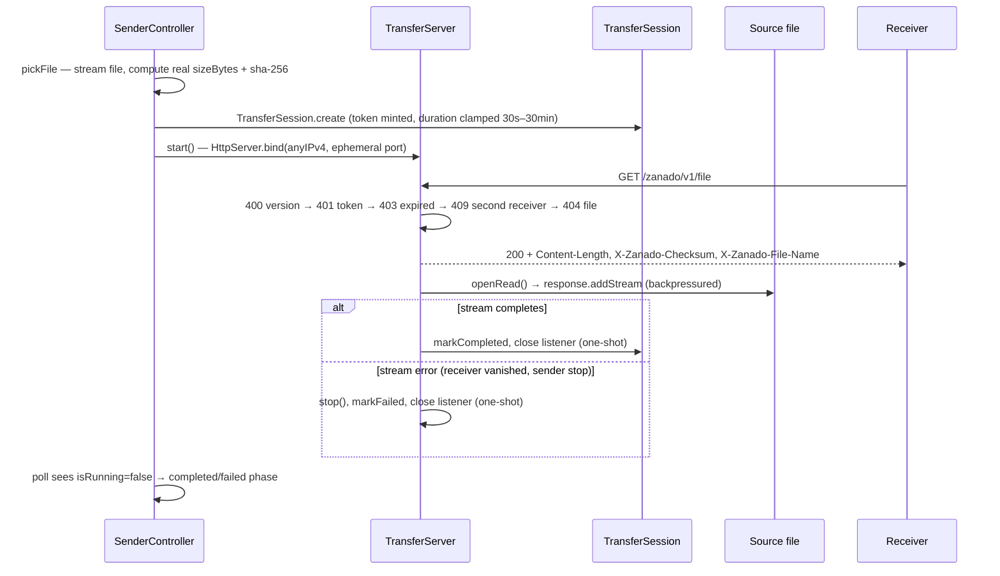
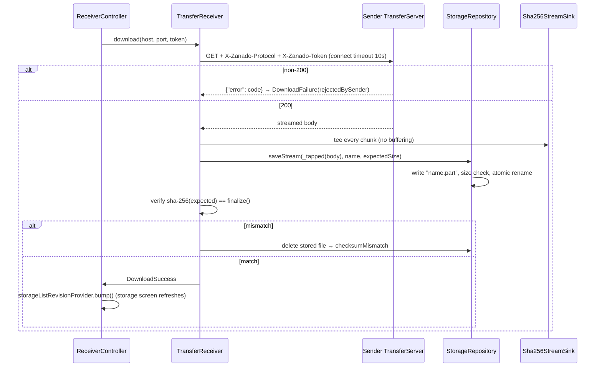

# Transfer flow

The full lifecycle of one LAN transfer, as implemented in v1.0. Sender side follows `lib/features/transfer/transfer_controller.dart` → `lib/data/network/transfer_server.dart`; receiver side follows `lib/data/network/transfer_receiver.dart` → the storage repository.

## Sender

## Receiver

## Failure classification

`DownloadFailureKind` values: `connection` (SocketException/HttpException, including a 30 s idle timeout on a stalled connection), `protocol` (missing/malformed headers), `rejectedBySender` (401/403/404/409/400 + parsed code), `sizeMismatch`, `checksumMismatch`, `storage`.

## Invariants

- One-shot session: any terminal state closes the listener; token/port never reused.
- `.part`-then-rename: an interrupted download never appears completed.
- Sender `completed` is NOT proof of receiver success — receiver checksum verification is authoritative (transport buffering can hide a vanished receiver).
- Expiry is checked at request time only; an accepted stream always completes.
- Single-receiver enforcement via 409 while a response is being streamed.
